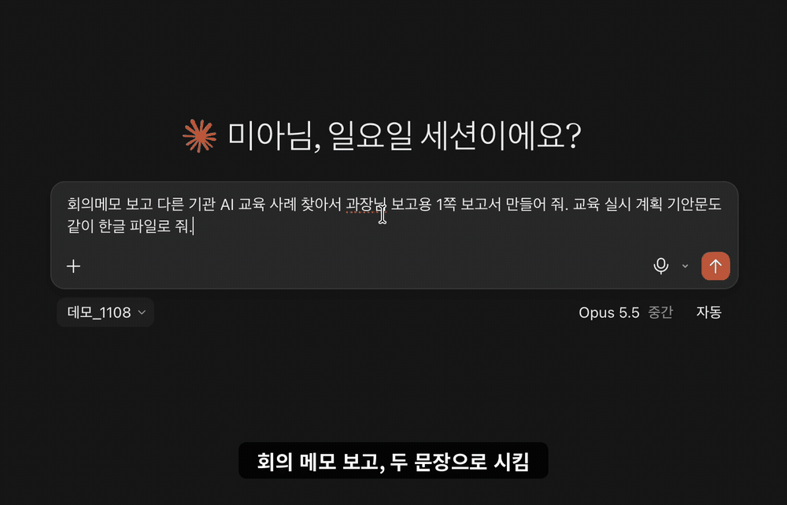
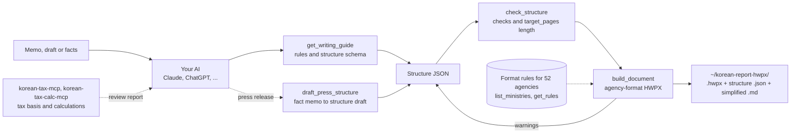

# korean-report-hwpx — Korean Government Documents MCP (reports, press releases and official drafts as HWPX)

<!-- mcp-name: io.github.UpstageAI/korean-report-hwpx -->



<sub>Demo: in the Claude app (Cowork), one request — "From the meeting memo, find other agencies' AI training cases and make a 1-page report for the director, plus an official draft for the training plan, as Hangul files" — produces a 1-page report with a case table and an internal approval draft that attaches the report (budget written with the Korean amount, '금1,200,000원(금일백이십만원)'). Published 2026-11-08; the meeting memo is fictitious.</sub>

[](https://pypi.org/project/korean-report-hwpx/) [](https://registry.modelcontextprotocol.io/v0/servers?search=io.github.UpstageAI/korean-report-hwpx) [](LICENSE) [](https://www.upstage.ai/) · [한국어](README.md)

**Korean civil-service documents (reports, press releases and official drafts) as HWPX, in each agency's format.** Your own AI (Claude, ChatGPT, …) structures the memo or draft; this server gives it the writing rules, checks the structure, and draws a Hangul (HWPX) file from format rules for 52 central government agencies, measured from 2,670 published press releases. 7 tools; nothing leaves your machine and no API key is needed.

> Output is a draft — check it in Hangul before use. This server sends nothing anywhere.

## Install

**Claude Code** — one line: `claude mcp add korean-report-hwpx -- uvx korean-report-hwpx`

**Claude app (desktop, Cowork)** — 3 steps

1. **Install uv** (once) — paste into Terminal (macOS) or PowerShell (Windows).
   - macOS: `curl -LsSf https://astral.sh/uv/install.sh | sh`
   - Windows: `powershell -ExecutionPolicy ByPass -c "irm https://astral.sh/uv/install.ps1 | iex"`
2. **Claude app Settings → Developer → Edit Config** opens `claude_desktop_config.json`; add the `mcpServers` entry below and save.
   If the app cannot find `uvx`, put the full path in `command` (on macOS, `which uvx` in Terminal, e.g. `/Users/you/.local/bin/uvx`).
3. **Quit the Claude app completely, reopen it**, and ask "Turn this memo into a 1-page report".

```json
{
  "mcpServers": {
    "korean-report-hwpx": {
      "command": "uvx",
      "args": ["korean-report-hwpx"]
    }
  }
}
```

- No API key or environment variables required. Files are written to `~/korean-report-hwpx/` (override with `KOREAN_REPORT_HWPX_OUT_DIR`; the old `KOREAN_GOV_DOCS_OUT_DIR` is also read).
- Windows: [docs/WINDOWS.md](docs/WINDOWS.md)

## How it works



With the tax MCPs ([korean-tax-mcp](https://github.com/UpstageAI/korean-tax-mcp), [korean-tax-calc-mcp](https://github.com/UpstageAI/korean-tax-calc-mcp)) the chain runs from legal basis → calculation → review report as HWPX.

## Try asking

Ask your AI as usual; you do not need the tool names.

| Ask | You get |
|---|---|
| "Make yesterday's meeting results a **1-page report** for the director" | Body filled to one page, details in attachments; on overflow or underfill the AI rebuilds from the `target_pages` warnings |
| "Turn this memo into a report for <agency name>" | Report format of one of 42 agencies (common format when no agency is given) |
| "Make it an **internal approval** report" | Internal approval format (`'26. 11. 8.(일) / 과명`, page number "- n -") |
| "Use the **numbered simplified style**, with Markdown too" | Ⅰ. 1. 가. numbering + a .md file |
| "Make this a National Tax Service (국세청) press release — embargo 2026. 10. 8.(Thu) morning papers" | Press release in one of 52 agency formats, with lead, title, quote and number checks |
| "Write the official draft (기안문) to get this report approved, attaching the report" | Official draft (별지 제1호서식) with item numbers, approval table and "끝." added |
| "Rebuild the report from before with a new □ sentence in section Ⅲ" | Rebuilt from the structure (.json) saved next to the file |
| "Show the report format rules for 산림청" | Marks, fonts, sizes and blank lines per level |

Reviews, plans, meeting results and status reports are all built as reports ("These are meeting notes — format them as an official document" works too; no agency → common format). You can chain report → press release → official draft from the same material.

## Links

[한국어 README](README.md) · [llms.txt](llms.txt) · [CHANGELOG](CHANGELOG.md) · [PyPI](https://pypi.org/project/korean-report-hwpx/) · [Site](https://upstageai.github.io/korean-tax-mcp/) · companions [korean-tax-mcp](https://github.com/UpstageAI/korean-tax-mcp), [korean-tax-calc-mcp](https://github.com/UpstageAI/korean-tax-calc-mcp)

> ⭐ If it helps, a star keeps this free project going.

---

<details>
<summary><b>Tools (7)</b></summary>

| Tool | What it does |
|---|---|
| `get_writing_guide` | Type-choice criteria, writing rules (□ one-sentence conclusion first, ㅇ grounds, - details, noun-form endings, no invented facts/numbers, no marks in text, appendix structure, official doc item numbering/dates/amounts/end mark/attachments), structure JSON schema and examples. Also as MCP prompt `writing_guide` |
| `draft_press_structure` | Turns a fact memo (who·when·what, background·key points·plan, quote, contact, numbers, etc.) into a press-release structure JSON draft. It does not invent sentences, numbers, or names not in the memo; it places the lead, quote, tables, and appendix per the rules |
| `check_structure` | Pre-build check: required fields, marks in text, skipped levels, multi-sentence □, non-noun-form endings, long titles, `target_pages` length; for official docs also: required keys, to/disclosure allowed values, approval drafter/approver required, attachments must be string list |
| `build_document` | Structure JSON → agency-format HWPX; normalizes input (strips marks, dashes, leading spaces) and returns `warnings`. For official docs use `doc_type="official"`; amount Korean annotation warnings and date normalization included |
| `build_from_structure` | Alias of `build_document` (former name, same arguments) |
| `list_ministries` | Supported agencies and support per document type (reports: agency/common rules; press releases: body style; official docs: common format) |
| `get_rules` | Format rules per agency and document type (marks, fonts, sizes, indents, gaps, title box, table header; official docs: rules_official/_공통.json) |

</details>

<details>
<summary><b>What a report looks like</b></summary>

| Feature | What you get |
|---|---|
| Outline levels | Section headings (Ⅰ. Ⅱ.) → □ one-sentence conclusion → ㅇ grounds → - details → * footnote, ※ note. Marks, indents and fonts follow the agency's rule values |
| Emphasis and footnotes | `**key phrase**` becomes bold; `*` and `**` inside a sentence become superscript footnote marks |
| Attachment marks | "붙임 1" or "참고 2" at the end of a sentence is drawn as a box; attachment and reference pages start on a new page with a header table |
| Tables | Thick top and bottom rules, double rule under the header row, light header shading, no left/right outer border. Columns of one-line cells are centered. The header row repeats when a table crosses a page |
| Length check | With a target page count (`target_pages`), the server measures body pages and last-page fill and warns on overflow, underfill or a missing appendix |
| 1-page report rules | "The first page is the whole report": overview as a table, each □ compressed to one sentence, filled so nobody has to ask back, details in attachments (in the writing guide) |
| Character spacing | Spacing and width are chosen per paragraph so the last line does not end with one or two characters. With macOS + Hangul, `polish=True` refines this against the real line layout |
| Three styles | Standard · internal approval (`report_kind="internal"`) · simplified (`style="simplified"`, with Markdown output) |

</details>

<details>
<summary><b>Document types and length check</b></summary>

| Type | Layout | Agency | Rules |
|---|---|---|---|
| **Report (개조식 outline)** | Title box, date/department line (optional), section headings (Ⅰ. Ⅱ.) → □ → ㅇ → - → *, ※ notes, tables, attachment pages (붙임·참고) | Optional — 42 agencies have their own rules; others or none use common rules | `rules_report/` (1,326 report-style sections) |
| **Press release (보도자료)** | Cover (logo slot), embargo/distribution, title and subtitles, body (paragraph / □ outline), contact table, appendix pages | Required — 52 agencies | `rules/`, `templates/` (2,670 releases) |
| **Draft approval document / official notice (기안문·시행문, 별지 제1호서식)** | Header (org centered), body with auto-numbered items (1.→가.→1)→가)→(1)→(가)), attachments, "끝." end mark, closing block (sender, recipients, approval table, coordinators, issue/receive, address, contact, disclosure) | Common format (rules_official/_공통.json), no agency needed | `rules_official/_공통.json` (Regulation Art.7, Enforcement Rule Art.2/4/6) |

**Flow** — ask your AI "turn this memo into a <agency name> report" → it reads `get_writing_guide` → writes the structure JSON → calls `build_document` → if `warnings` come back, it fixes the structure and builds again.

**Length check**: when the user gives a length ("1 page", "within 3 pages"), the AI passes it as `target_pages`; the server predicts the body page count and last-page fill and warns when the document overflows, is underfilled (below 80%), or has no appendix. Without a length, there is no page limit. The prediction is built by stacking the document with Hangul's layout rules (widow/orphan control, heading kept with next paragraph, tables split by row with repeated header). Page counts matched on all 54 documents measured in Hancom Office Hangul for Mac (1–6 pages, all three styles).

Type choice (in the guide): public announcement or distribution → press release; internal reporting, plans or reviews → report; for a draft approval document / official notice (별지 제1호서식) → `official`.

</details>

<details>
<summary><b>Writing a press release, with a fact-memo example</b></summary>

Call `get_writing_guide(doc_type='press_release', ministry=agency)` to get press-release writing guidance (lead, title, quote, numbers, plain language) plus the fact-memo template and per-agency example structures. The guidance is based on the National Institute of Korean Language's press-release writing guides and a measurement of 2,667 Korea.kr press releases (the 2,667 of the 2,670 collected releases used for body-text measurement).

**Fact-memo example (과학기술정보통신부, fictitious):**
```json
{
  "kind": "보도자료",
  "ministry": "과학기술정보통신부",
  "release": "2026. 11. 4.(수) 조간",
  "headline": "어르신 디지털 배움터 키오스크 교육 4,820명 수료",
  "subtitles": ["교육장 37곳 운영 결과, 수료생 만족도 92.4%"],
  "who": "과학기술정보통신부(장관 ○○○)",
  "when": "11월 3일(화)",
  "what": "올해 어르신 디지털 배움터 키오스크 교육 운영 결과를 발표했다",
  "points": ["3월부터 10월까지 전국 교육장 37곳에서 어르신 4,820명이 교육을 마쳤다."],
  "numbers": [{"item": "수료 인원", "value": "4,820", "unit": "명", "basis": "2026. 3.~10."}],
  "quote": {"speaker": "○○○ 과학기술정보통신부 장관", "text": ["어르신 누구나 무인 기기를 불편 없이 쓸 수 있도록 가까운 곳에서 배울 기회를 넓히겠다."], "verb": "말했다"},
  "contact": {"dept": "과학기술정보통신부 디지털포용정책과", "people": [["책임자", "과장", "○○○", "(044-202-0000)"]]}
}
```

Then: `draft_press_structure(facts, ministry)` → structure JSON draft + missing/warnings → refine sentences → `check_structure(structure, 'press_release', ministry=agency)` → `build_document(structure, 'press_release', agency)`.

**Sources:**
- National Institute of Korean Language, 『유형별로 알아보는 보도자료 작성 길잡이』 (2020) — G20
- National Institute of Korean Language, 『보도자료 유형별 표준안 개발』 (2020) — R20
- National Institute of Korean Language, 『보도 자료 쓰기 길잡이』 (2011) — G11
- National Institute of Korean Language, 『개정판 한눈에 알아보는 공공언어 바로 쓰기』 (2022) — H22
- Ministry of Culture, Sports and Tourism·National Institute of Korean Language, 『쉬운 공공언어 쓰기 길잡이』 (2014) — E14
- Korea.kr (정책브리핑) press releases, 2,667 documents, body text measurement (52 central agencies) — C

</details>

<details>
<summary><b>Simplified style (style="simplified")</b></summary>

A report style that is easy for AI to read (standardized numbering, prose sentences, simple tables). Item marks are replaced by level numbers, and the title box and header shading are removed.

**Usage**: `build_document(..., style="simplified")` or `get_writing_guide(..., style="simplified")`.

**What changes**:
- Level numbers instead of marks (□ ㅇ ○ - * ※): Ⅰ. Ⅱ. Ⅲ. (section) → 1. 2. 3. → 가. 나. 다. → 1) 2) 3) → 가) 나) 다)
- The server computes numbers from each block's level in the structure JSON; do not write numbers yourself
- Indentation per level is kept
- Prose sentences are allowed (verb endings; no noun-form-ending warning)
- Plain title paragraph instead of a bordered, shaded title box
- No table header shading
- Automatic table numbering: `〈표 1〉 title` (write only the title in `caption`)
- No merged cells: merged values are repeated in every row
- `export_markdown=True`: saves a .md file from the same structure (GFM tables, #, ##, ### headings)
- Line spacing 150%, space before paragraphs 10pt (level 1) / 5pt (others), no blank lines
- Numbers are inserted as text. Linking to Hangul's outline numbering is planned for a later version

</details>

<details>
<summary><b>Internal approval report (report_kind="internal")</b></summary>

Reflects measurements of real internal approval reports from Korea's information disclosure portal (정보공개포털, open.go.kr): title without a label cell, a date/department line `'26. 10. 9.(금) / 과·팀명`, line spacing 150%, space before paragraphs 10pt (□) / 5pt (ㅇ, -).

**Example**:
```json
{
  "title": "○○ 추진계획(안)", "date": "2026. 10. 7.", "dept": "○○과",
  "body": [
    {"type": "h", "text": "추진 배경"},
    {"type": "l1", "text": "민원 대기 시간 감소를 위해 AI 안내 도입 필요"},
    {"type": "l2", "text": "하루 평균 창구 민원 약 400건"},
    {"type": "caption", "text": "소요 예산"},
    {"type": "table", "rows": [["구분", "금액"], ["시스템 구축", "2억"]]}
  ]
}
```
→ In simplified style this renders as `Ⅰ. 추진 배경`, `1. 민원 대기 시간 감소를 위해 AI 안내 도입 필요`, `가. 하루 평균 창구 민원 약 400건`, `〈표 1〉 소요 예산`.

</details>

<details>
<summary><b>Structure JSON examples — report, press release, official draft</b></summary>

Report structure JSON:

```json
{
  "title": "○○ 서비스 도입 추진계획(안)", "date": "2026. 10. 7.", "dept": "○○과",
  "body": [{"type": "h", "text": "Ⅰ. 추진 배경"},
           {"type": "l1", "text": "..."}, {"type": "l2", "text": "..."}, {"type": "l3", "text": "..."},
           {"type": "note", "text": "..."}, {"type": "ref", "text": "..."},
           {"type": "caption", "text": "소요 예산"}, {"type": "table", "rows": [["구분", "금액"], ["가", "100"]]}],
  "appendix": [{"title": "붙임 1", "heading": "...", "body": [{"type": "l1", "text": "..."}]}]
}
```

Press release structure: `{release, distribute, title, subtitles, body, appendix, contact}` (same block types plus `p` paragraph, `box`, `image`). Without a contact, the contact table is filled with placeholders `○○과 / 김○○ / 044-000-0000` (`placeholder_contact`).

Official document (기안문·시행문, 별지 제1호서식) structure — use `doc_type="official"`:
```json
{
  "org": "행정안전부",            // Header agency name (required). Upper agency combined in one line, e.g. "국무조정실 ○○위원회"
  "to": "수신자 참조",             // Required. "내부결재" | "○○장관(○○과장)" | "수신자 참조"
  "via": "",                       // Via (optional). If present, shown as "(경유)  {via}"
  "title": "2026년 ○○ 계획 알림",  // Required
  "body": [                        // Item numbers (1.→가.→1)→가)→(1)→(가)) assigned by the server
    {"type": "l1", "text": "..."},
    {"type": "l2", "text": "..."},
    {"type": "l3", "text": "..."},
    {"type": "table", "rows": [[...]]},
    {"type": "lines", "lines": ["..."]}
  ],
  "attachments": ["○○ 계획서 1부.", "○○ 명단 1부."],  // Optional
  "recipients": ["○○부장관", "○○청장"],                // Shown in closing when to="수신자 참조"
  "sender": "행정안전부장관",            // Sender name (required)
  "approval": {                          // Approval block (required: drafter and approver)
    "drafter":   {"title": "주무관", "name": "", "mark": "★"},
    "reviewers": [{"title": "과장", "name": "", "opinion": false}],
    "approver":  {"title": "국장", "name": ""},
    "coordinators": [{"title": "○○과장"}]
  },
  "doc_no": {"issue": "○○과-1234", "issue_date": "2026. 10. 14.", "receive": "", "receive_date": ""},
  "contact": {"zip": "30112", "address": "세종특별자치시 ○○로 00", "homepage": "www.mois.go.kr",
              "phone": "044-000-0000", "fax": "044-000-0001", "email": "○○○@korea.kr", "disclosure": "공개"}
}
```
Item numbering: l1→1. / l2→가. / l3→1) / l4→가) / l5→(1) / l6→(가). Numbers increment sequentially within the same level, and reset when a higher level changes (제2조①). Second level and below are indented 2 characters (2타) to the right from the higher-level number start. Amounts must be written with Korean annotation, e.g. `금113,560원(금일십일만삼천오백육십원)`; if missing, `warnings` will contain "금액 한글 병기 필요(시행규칙 제2조②)" (제2조②). Dates are normalized from YYYY-MM-DD / YYYY.MM.DD to YYYY. MM. DD. (영 제7조⑤). `disclosure` must be one of "공개", "부분공개", "비공개".

</details>

<details>
<summary><b>Supported agencies (52)</b></summary>

| Agency | Report | Press release | Agency | Report | Press release |
|---|---|---|---|---|---|
| 개인정보보호위원회 | agency rules | paragraph | 법무부 | agency rules | □ outline |
| 경찰청 | agency rules | paragraph | 법제처 | agency rules | paragraph |
| 고용노동부 | agency rules | paragraph | 병무청 | common rules | paragraph |
| 공정거래위원회 | agency rules | paragraph | 보건복지부 | agency rules | paragraph |
| 과학기술정보통신부 | agency rules | paragraph | 산림청 | agency rules | paragraph |
| 관세청 | agency rules | paragraph | 산업통상부 | agency rules | paragraph |
| 교육부 | agency rules | paragraph | 새만금개발청 | common rules | □ outline |
| 국가교육위원회 | agency rules | paragraph | 성평등가족부 | agency rules | □ outline |
| 국가데이터처 | agency rules | □ outline | 소방청 | common rules | □ outline |
| 국가보훈부 | agency rules | paragraph | 식품의약품안전처 | agency rules | paragraph |
| 국가유산청 | agency rules | paragraph | 외교부 | common rules | paragraph |
| 국무조정실 | agency rules | □ outline | 우주항공청 | agency rules | paragraph |
| 국민권익위원회 | agency rules | □ outline | 원자력안전위원회 | common rules | □ outline |
| 국방부 | agency rules | □ outline | 인구전략위원회 | common rules | paragraph |
| 국세청 | agency rules | □ outline | 인사혁신처 | agency rules | paragraph |
| 국토교통부 | agency rules | □ outline | 재외동포청 | common rules | □ outline |
| 금융위원회 | agency rules | paragraph | 재정경제부 | agency rules | paragraph |
| 기본사회위원회 | common rules | □ outline | 조달청 | agency rules | paragraph |
| 기상청 | agency rules | paragraph | 중소벤처기업부 | agency rules | paragraph |
| 기획예산처 | agency rules | paragraph | 지식재산처 | agency rules | paragraph |
| 기후에너지환경부 | agency rules | paragraph | 질병관리청 | agency rules | paragraph |
| 농림축산식품부 | agency rules | paragraph | 통일부 | common rules | □ outline |
| 농촌진흥청 | agency rules | paragraph | 해양경찰청 | common rules | □ outline |
| 문화체육관광부 | agency rules | paragraph | 해양수산부 | agency rules | paragraph |
| 방송미디어통신위원회 | agency rules | paragraph | 행정안전부 | agency rules | paragraph |
| 방위사업청 | agency rules | paragraph | 행정중심복합도시건설청 | agency rules | paragraph |

Report: agency rules = measured from that agency's attachment sections (42 agencies); common rules = most common values across agencies (agency name left blank when none is given). Press release: paragraph = article-style paragraphs; □ outline = □ → ㅇ → -.

</details>

<details>
<summary><b>Agency logos</b></summary>

Government symbols and agency logos are not bundled (usage regulations). Agency staff should supply their own logo file.

- `logo_path` places the logo in the press release cover's logo slot (sized per agency) or above the report title box. `slogan_path` adds a press release slogan image.
- Without it, press releases get a same-size 「기관 로고」 placeholder; delete the text in Hangul and insert the picture.

</details>

<details>
<summary><b>Basis — study of 2,670 press releases and official standards</b></summary>

- Full parse of **2,670 press release HWPX files (52 central agencies)** from Korea.kr (정책브리핑). Press release body formatting measured on 2,016 releases: 35,465 paragraphs, 35,434 blank lines, 32,392 table cells.
- Report formatting comes from the **1,326** releases that contain a report-style attachment section (13,757 paragraphs), per agency (42 agencies with 3+ documents). The common skeleton (□ - * ※ marks, one space after the mark, one-row title box, table header in 맑은 고딕 centered bold) agrees across 90%+ of agencies.
- Official standards: item numbering in the Enforcement Rule of the Regulation on Administrative Business Operation and Innovation (1. → 가. → 1) → 가) …), and Gyeonggi Provincial Office of Education's guide 「한 곳에 정리한 공문서 작성법」 (wrapped lines align to the item's first character, one space after the mark, sub-items indented by two spaces, etc.).
- Measurement: 2,670 Korea.kr press releases from 52 agencies (1,326 with a report section), from which per-agency marks, fonts, blank lines and cover-table values were derived.
- Rule documents: `korean_report_hwpx/refs/`. Rule values: `rules/`, `rules_report/`; press release cover/contact numbers: `templates/`.
- Source releases are published on Korea.kr under KOGL (공공누리). This repository contains no source files, text or images — only format numbers.
- Counts: format rules (marks, fonts, blank lines, report sections) come from a full parse of all 2,670 collected releases; body-text measurement and page settings use 2,667 of the same releases.

</details>

<details>
<summary><b>Format basis (page settings)</b></summary>

Every document type (report, press release, draft approval document) uses A4 (210×297 mm, HWPUNIT 59528×84188) as the editing page, with left/right margins 20 mm (HWPUNIT 5669), top/bottom margins 15 mm (HWPUNIT 4252), header/footer 10 mm (HWPUNIT 2835), and gutter 0 as the default. The text width is width − left − right = 48190 (HWPUNIT, 170 mm); a table (`<hp:tbl>`) never exceeds the text width.

- Basis: of 2,667 Korea.kr press releases (52 central agencies) measured, 2,640 used A4 with 20 mm left/right margins, and 1,817 used top 15 mm / bottom 15 mm / header 10 mm / footer 10 mm (the most common combination). Ministry of Science and ICT: 100 of 118; Ministry of the Interior and Safety: 120 of 135.
- When an agency template (`templates/<agency>.json`, `page`) exists, its most common values (agency value) are used; if the sample is fewer than 10 documents, the common default is used. Agency values, with their basis, are recorded in `korean_report_hwpx/rules/_쪽설정.json` under `기관값`.
- Draft approval documents use the same common values per Art. 7⑥ of the Regulation on Administrative Business Operation and Innovation (page size A4).
- Rule file: `korean_report_hwpx/rules/_쪽설정.json`.

</details>

<details>
<summary><b>Authorship (Solar Pro 4, Claude)</b></summary>

- 0.2.0 through 0.3.x: written by Solar Pro 4, reviewed by CodeSolar and Claude.
- From 0.4.0: the skeleton is Solar Pro 4; additions, specs and answer-key tests (including Hangul measurements) are by Claude. 0.5.2 and 0.5.6 were written by Claude.
- Per-version authorship is stated at the top of each section in the [CHANGELOG](CHANGELOG.md).

</details>

<details>
<summary><b>Notes and data transmission</b></summary>

- Output is a draft. Check it in Hangul before use.
- Line ends (e.g. a one- or two-character last line) are fitted from estimated glyph widths, so some may remain. With **macOS + Hancom Office Hangul**, `polish=True` reads the real line layout and re-chooses spacing per paragraph (Hangul windows open several times; takes minutes).
- Fonts render with whatever is installed; missing fonts (e.g. 휴먼명조, HY헤드라인M) are substituted.
- Draft approval documents / official notices (기안문·시행문) are supported with `doc_type="official"` (별지 제1호서식, rules_official/_공통.json). Item numbers (1.→가.→1)→가)→(1)→(가)) are assigned by the server; do not write numbers yourself. Dates are normalized from YYYY-MM-DD / YYYY.MM.DD to YYYY. MM. DD.
- Everything is local. This server calls no external API and sends neither drafts nor output files anywhere.
- Structuring the draft is done by the AI you use; check that service's own data policy.

</details>

MIT © 2026 Upstage · Created by Mia(윤승미)
