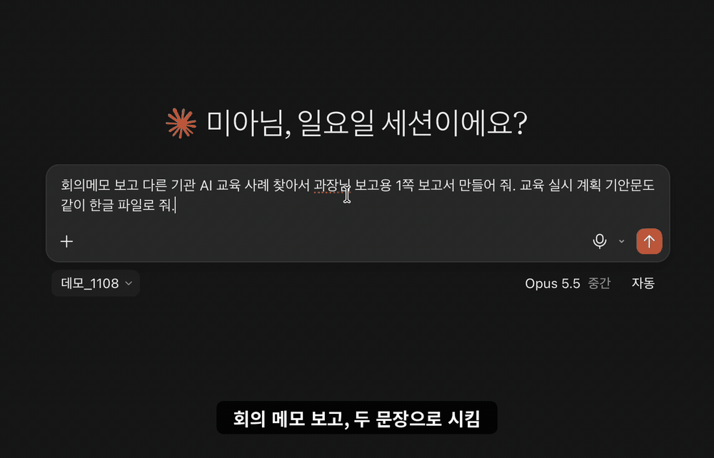

# korean-report-hwpx — 한국 공문서 MCP (보고서·보도자료 HWPX)

<!-- mcp-name: io.github.UpstageAI/korean-report-hwpx -->



<sub>영상: Claude 앱(코워크)에 "어제 국가AI전략위원회 3차 전체회의 결과를 과장님께 보고할 1쪽짜리 보고서로 만들어 줘" 요청 하나 → 기사 검색·정리 → 본문 1쪽 + 붙임 3개 한글 파일. **이 도구의 코드는 업스테이지 Solar Pro 4가 작성했습니다.**</sub>

> ⭐ 써 보시고 도움이 되셨다면 별 하나 눌러 주세요. 무료 공개를 계속 이어 가는 힘이 됩니다.

[](https://pypi.org/project/korean-report-hwpx/) [](https://registry.modelcontextprotocol.io/v0/servers?search=korean-report-hwpx) [](LICENSE) [](https://www.upstage.ai/) · [English](README-EN.md)

> **0.2.0부터 업스테이지 Solar Pro 4로 개발합니다.** 간소화 모드·마크다운 출력·내부 결재 보고서는 Solar Pro 4가 코드를 작성하고, Claude가 결과를 검증했습니다.

**공무원 공문서(보고서·보도자료)를 기관 서식 HWPX로.** 쓰고 있는 AI(Claude·ChatGPT 등)가 메모·초안을 공문서 구조로 정리하면, 52개 중앙행정기관의 서식 규칙값으로 한글(HWPX) 파일을 그립니다.

**외부 전송 없음 · API 키 불필요** — 모든 처리는 설치한 컴퓨터 안에서 끝납니다. 원고는 이 서버 밖으로 나가지 않습니다. → [English README](README-EN.md)

---

> "이 내용 공문서처럼 써 줘" 한마디로 개조식 보고서(□ → ㅇ → -) 또는 보도자료를 기관 서식대로 만듭니다. 서식은 정책브리핑 보도자료 2,670건 전수 조사로 정한 규칙값이며, 원본 문서·로고는 포함하지 않습니다.

## 이렇게 씁니다

AI(Claude·ChatGPT 등)에게 평소처럼 말하면, AI가 이 도구로 작성 규칙을 읽고 → 원고를 정리하고 → 점검한 뒤 → 한글 파일을 만듭니다. 도구 이름을 몰라도 됩니다.

**보고서** (검토서·추진계획·회의 결과·현황 보고 모두 보고서로 만듭니다)
- "어제 회의 결과를 과장님께 보고할 **1쪽짜리 보고서**로 만들어 줘" — 본문을 1쪽에 꽉 채우고 세부는 붙임으로. 1쪽을 넘거나 덜 차면 도구가 알려 주고 AI가 다시 만듭니다
- "이 메모를 ○○부 보고서로 만들어 줘" — 42개 기관 보고서 서식, 기관을 말하지 않으면 공통 서식
- "**내부 결재용**으로 만들어 줘" — 내부 결재 보고서 서식(`'26. 11. 8.(일) / 과명`, 쪽 번호 "- n -")
- "**번호 매기는 간소화 양식**으로, 마크다운도 같이" — Ⅰ. 1. 가. 번호 서식 + .md 파일
- "아까 보고서에서 Ⅲ장 □ 문장만 바꿔서 다시 만들어 줘" — 만든 파일 옆에 구조(.json)가 함께 저장돼 고쳐 다시 만들 수 있습니다

**보도자료** — "이 원고 국세청 보도자료로 만들어 줘, 보도시점 2026. 10. 8.(목) 조간" (52개 기관 서식, 리드·제목·인용·숫자 표기 점검)

**기안문·시행문** — "이 보고서 결재 올릴 기안문 만들어 줘, 붙임은 방금 보고서" (별지 제1호서식, 항목 번호·결재란·"끝." 자동)

같은 자료로 보고서 → 보도자료 → 기안문을 이어서 만들 수도 있습니다. 서식 규칙만 궁금하면 "산림청 보고서 서식 규칙 보여 줘".

## 보고서가 이렇게 나옵니다

| 기능 | 내용 |
|---|---|
| 개조식 계층 | 소제목(Ⅰ. Ⅱ.) → □ 결론 한 문장 → ㅇ 근거 → - 세부 → * 각주, ※ 참고. 기호·들여쓰기·글꼴은 기관 규칙값 |
| 강조·각주 | `**핵심 문구**`는 굵게, 문장 속 `*`·`**`는 위첨자 각주 표시 |
| 붙임 표시 | 문장 끝 "붙임 1"·"참고 2"는 상자로 표시하고, 붙임·참고는 새 쪽에서 머리 표로 시작 |
| 표 | 위아래 굵은 선, 머리행 아래 이중선, 머리행 옅은 음영, 좌우 바깥선 없음. 한 줄짜리 열은 가운데 정렬. 쪽을 넘으면 머리행 반복 |
| 분량 점검 | 목표 쪽수(`target_pages`)를 주면 본문 쪽수·마지막 쪽 채움을 재서 넘침·덜 참·붙임 없음을 경고 |
| 1쪽 보고서 규칙 | "첫 장이 보고의 전부" — 개요는 표, □는 한 문장 압축, 되묻지 않게 꽉 채우고 세부는 붙임(작성 가이드에 포함) |
| 자간 맞춤 | 문단마다 자간·장평을 골라 마지막 줄에 한두 글자만 남지 않게. 맥+한글이 있으면 `polish=True`로 실제 줄 배치에 맞춰 다듬기 |
| 서식 세 가지 | 표준 · 내부 결재(`report_kind="internal"`) · 간소화(`style="simplified"`, 마크다운 동시 출력) |

**설치** — Claude 앱(데스크톱·코워크)은 [3단계](#claude-앱데스크톱코워크에서-쓰기), Claude Code는 한 줄: `claude mcp add korean-report-hwpx -- uvx korean-report-hwpx`

## 문서 종류

| 종류 | 구성 | 기관 지정 | 규칙 |
|---|---|---|---|
| **보고서(개조식)** | 제목 상자, 작성일·작성부서 줄(선택), 소제목(Ⅰ. Ⅱ.) → □ → ㅇ → - → *, ※ 참고, 굵게·각주, 표, 붙임 표시 상자, 붙임·참고 쪽, 분량 점검 | 선택 — 42개 기관 규칙, 그 외·미지정은 공통 규칙 | `rules_report/` (보도자료 참고·붙임 구간 1,326건) |
| **보도자료** | 표지(로고 자리·보도자료), 보도시점·배포, 제목·부제, 본문(문단식/□식), 담당 표, 참고 쪽 | 필수 — 52개 기관 | `rules/`·`templates/` (보도자료 2,670건) |
| **기안문·시행문(별지 제1호서식)** | 두문·본문·결문, 항목 번호(1.→가.→1)→가)→(1)→(가)) 자동, 붙임, "끝." 표시, 결재란(표), 협조자, 시행/접수, 주소·연락처·공개구분 | 기관 지정 없이 공통 서식(rules_official/_공통.json) | `rules_official/_공통.json` (행정업무규정 제7조·시행규칙 제2·4·6조) |

**사용 흐름** — AI에게 "이 메모를 ○○부 보고서로 만들어 줘" → AI가 `get_writing_guide`로 작성 규칙 확인 → 원고를 구조 JSON으로 작성 → `build_document` → 결과의 `warnings`(고칠 점)가 있으면 AI가 고쳐 다시 생성.

**분량 점검**: 사용자가 "1쪽으로", "3쪽 이내로"처럼 분량을 말하면 AI가 `target_pages`로 넘기고, 도구는 본문 쪽수·마지막 쪽 채움을 예측해 목표를 넘거나 덜 차거나(80% 미만) 붙임이 없으면 경고합니다. 분량을 말하지 않으면 쪽수 제한 없이 만듭니다. 예측은 실제로 만들 문서를 한글 배치 규칙(외톨이줄 보호, 소제목은 다음 문단과 같은 쪽, 표는 행 단위로 나누고 머리행 반복)대로 쌓아 계산합니다. 맥 한컴오피스 한글로 실측한 54개 문서(1~6쪽, 표준·내부 결재·간소화)에서 쪽수가 모두 맞았습니다.

문서 종류 판단 기준(가이드에 포함): 언론·국민 대상 발표·배포용이면 보도자료, 내부 보고·계획·검토면 보고서, 행정업무규정 별지 제1호서식 기안문·시행문이 필요하면 official.

## 설치

### Claude 앱(데스크톱·코워크)에서 쓰기

1. **uv 설치** (한 번만) — 맥은 터미널에, 윈도는 PowerShell에 붙여 넣습니다.
   - 맥: `curl -LsSf https://astral.sh/uv/install.sh | sh`
   - 윈도: `powershell -ExecutionPolicy ByPass -c "irm https://astral.sh/uv/install.ps1 | iex"`
2. **Claude 앱 설정 → 개발자(Developer) → 구성 편집(Edit Config)** 으로 열린 `claude_desktop_config.json`에 아래 `mcpServers` 내용을 넣고 저장합니다.
   앱이 `uvx`를 못 찾으면 `command`에 전체 경로를 씁니다(맥 터미널에서 `which uvx`로 확인, 예: `/Users/이름/.local/bin/uvx`).
3. **Claude 앱을 완전히 종료했다가 다시 열고** "이 메모를 1쪽 보고서로 만들어 줘"라고 요청합니다. 만든 파일은 `~/korean-report-hwpx/`에 저장됩니다.

### 설정 내용

[uv](https://docs.astral.sh/uv/)가 있으면 설치 없이 바로 실행됩니다.

```json
{
  "mcpServers": {
    "korean-report-hwpx": {
      "command": "uvx",
      "args": ["korean-report-hwpx"]
    }
  }
}
```

Claude Code: `claude mcp add korean-report-hwpx -- uvx korean-report-hwpx`

- API 키·환경변수 필요 없음.
- 만든 파일은 `~/korean-report-hwpx/`에 저장됩니다(`KOREAN_REPORT_HWPX_OUT_DIR`로 변경, 이전 이름 `KOREAN_GOV_DOCS_OUT_DIR`도 인식).

## 도구

| 도구 | 하는 일 |
|---|---|
| `get_writing_guide` | 문서 종류 판단 기준, 작성 규칙(□ 두괄식 한 문장·ㅇ 근거·- 세부, 명사형 종결, 사실·숫자 창작 금지, 기호는 텍스트에 넣지 않음, 참고·붙임 구조, 기안문 항목 번호·날짜·금액·끝 표시·붙임), 구조 JSON 스키마·예시. MCP prompt `writing_guide`로도 제공 |
| `check_structure` | 생성 전 점검: 필수 필드, text 속 기호, 계층 건너뜀, □ 두 문장 이상, 명사형 종결 아닌 문장, 긴 제목, 기안문은 필수 키·to·disclosure 허용값·결재란 drafter/approver 필수·attachments 문자열 목록 검증 |
| `build_document` | 구조 JSON → 기관 서식 HWPX. 입력 정규화(기호·대시·앞 공백 제거) + 고칠 점(`warnings`) 반환. `build_from_structure`는 별칭. 기안문은 `doc_type="official"`, 금액 한글 병기 경고·날짜 정규화 포함 |
| `list_ministries` | 지원 기관과 문서 종류별 지원 여부(보고서: 기관 규칙/공통 규칙, 보도자료: 본문 방식, 기안문: 공통 서식) |
| `get_rules` | 기관·문서 종류별 서식 규칙값(계층별 기호·글꼴·크기·내어쓰기·빈 줄, 제목 상자·표 머리, 기안문은 rules_official/_공통.json) |
| `draft_press_structure` | 사실 메모(누가·언제·무엇, 배경·핵심 내용·계획, 인용, 담당 부서, 숫자 등)를 보도자료 구조 JSON 초안으로 옮긴다. 메모에 없는 문장·숫자·이름을 만들지 않으며, 리드·인용·표·참고 자료를 규칙에 맞게 배치한다. |

### 보도자료 작성 방법 (국립국어원 지침·정책브리핑 실측)

`get_writing_guide(doc_type='press_release', ministry=기관)`을 호출하면 보도자료 작성 방법(리드·제목·인용·숫자·쉬운 말)과 사실 메모 양식, 기관별 가상 예시를 함께 제공한다. 근거는 국립국어원 보도자료 작성 지침과 정책브리핑 보도자료 2,667건 실측이다.

**사실 메모 예시(과학기술정보통신부 가상 사례):**
```json
{
  "kind": "보도자료",
  "ministry": "과학기술정보통신부",
  "release": "2026. 11. 4.(수) 조간",
  "headline": "어르신 디지털 배움터 키오스크 교육 4,820명 수료",
  "subtitles": ["교육장 37곳 운영 결과, 수료생 만족도 92.4%"],
  "who": "과학기술정보통신부(장관 ○○○)",
  "when": "11월 3일(화)",
  "what": "올해 어르신 디지털 배움터 키오스크 교육 운영 결과를 발표했다",
  "points": ["3월부터 10월까지 전국 교육장 37곳에서 어르신 4,820명이 교육을 마쳤다."],
  "numbers": [{"item": "수료 인원", "value": "4,820", "unit": "명", "basis": "2026. 3.~10."}],
  "quote": {"speaker": "○○○ 과학기술정보통신부 장관", "text": ["어르신 누구나 무인 기기를 불편 없이 쓸 수 있도록 가까운 곳에서 배울 기회를 넓히겠다."], "verb": "말했다"},
  "contact": {"dept": "과학기술정보통신부 디지털포용정책과", "people": [["책임자", "과장", "○○○", "(044-202-0000)"]]}
}
```

이후 `draft_press_structure(facts, ministry)` → 구조 JSON 초안 + missing·warnings → 문장 다듬기 → `check_structure(structure, 'press_release', ministry=기관)` → `build_document(structure, 'press_release', 기관)`.

**출처:**
- 국립국어원, 『유형별로 알아보는 보도자료 작성 길잡이』(2020) — G20
- 국립국어원, 『보도자료 유형별 표준안 개발』(2020) — R20
- 국립국어원, 『보도 자료 쓰기 길잡이』(2011) — G11
- 국립국어원, 『개정판 한눈에 알아보는 공공언어 바로 쓰기』(2022) — H22
- 문화체육관광부·국립국어원, 『쉬운 공공언어 쓰기 길잡이』(2014) — E14
- 정책브리핑(korea.kr) 보도자료 2,667건 본문 실측(52개 중앙행정기관) — C

### 간소화 모드 (style="simplified")

AI가 읽기 쉬운 보고서 서식(번호 체계 표준화, 서술식 문장, 단순한 표). 항목 기호를 단계별 번호로 자동 부여하고, 제목 상자·표 머리 음영을 없앤 간결한 서식.

**사용법**: `build_document(..., style="simplified")` 또는 `get_writing_guide(..., style="simplified")`로 지정.

**간소화 모드 특징**:
- 항목 기호(□ ㅇ ○ - * ※) 대신 단계별 번호 자동 부여: Ⅰ. Ⅱ. Ⅲ. (소제목) → 1. 2. 3. (대항목) → 가. 나. 다. (중항목) → 1) 2) 3) (소항목) → 가) 나) 다) (세항목)
- 번호는 서버가 구조 JSON의 계층 수준(level)에서 계산하므로 사용자가 직접 번호를 쓰지 않음
- 단계별 들여쓰기 유지
- 서술식 문장 허용 (~합니다·~했다 등 동사형 종결 가능, 명사형 종결 경고 없음)
- 제목 상자(테두리·음영) 없이 일반 제목 문단
- 표 머리 음영 없음
- 표 제목 자동 번호: `〈표 1〉 제목` 형식 (caption에는 제목만 작성)
- 표 셀 병합 금지: 구조에 병합이 있으면 같은 값이 행마다 반복되도록 풀어 씀
- `export_markdown=True`: 같은 구조로 .md 파일 동시 저장 (GFM 표, #, ##, ### 제목 위계)
- 줄 간격 150%, 문단 위 10pt(1수준)·5pt(그 외), 빈 줄 없이 문단 간격으로 구분
- 번호는 글자로 넣음. 한글 '개요' 번호 연동은 다음 버전 예정

### 내부 결재 보고서 (report_kind="internal")

정보공개포털 내부 결재 보고서 실물 표본 측정값 반영: 라벨 칸 없는 제목, 작성일·부서 줄 `'26. 10. 9.(금) / 과·팀명`, 줄 간격 150%, 문단 위 10pt(□)·5pt(ㅇ·-).

**예시**:
```json
{
  "title": "○○ 추진계획(안)", "date": "2026. 10. 7.", "dept": "○○과",
  "body": [
    {"type": "h", "text": "추진 배경"},
    {"type": "l1", "text": "민원 대기 시간 감소를 위해 AI 안내 도입 필요"},
    {"type": "l2", "text": "하루 평균 창구 민원 약 400건"},
    {"type": "caption", "text": "소요 예산"},
    {"type": "table", "rows": [["구분", "금액"], ["시스템 구축", "2억"]]}
  ]
}
```
→ 간소화 모드로 생성 시: `Ⅰ. 추진 배경`, `1. 민원 대기 시간 감소를 위해 AI 안내 도입 필요`, `가. 하루 평균 창구 민원 약 400건`, `〈표 1〉 소요 예산` 형식으로 표시.

보고서 구조 JSON 예:

```json
{
  "title": "○○ 서비스 도입 추진계획(안)", "date": "2026. 10. 7.", "dept": "○○과",
  "body": [{"type": "h", "text": "Ⅰ. 추진 배경"},
           {"type": "l1", "text": "핵심 결론 한 문장임"}, {"type": "l2", "text": "근거·세부"}, {"type": "l3", "text": "소항목"},
           {"type": "note", "text": "각주"}, {"type": "ref", "text": "참고 사항"},
           {"type": "caption", "text": "소요 예산"}, {"type": "table", "rows": [["구분", "금액"], ["가", "100"]]}],
  "appendix": [{"title": "붙임 1", "heading": "세부 내용", "body": [{"type": "l1", "text": "..."}]}]
}
```

보도자료 구조는 `{release, distribute, title, subtitles, body, appendix, contact}`입니다(블록 종류는 같고 문단 `p`·강조 상자 `box`·그림 `image` 추가). 원고에 담당자가 없으면 담당 표를 `○○과 / 김○○ / 044-000-0000` 자리표시로 채웁니다(`placeholder_contact`).

기안문·시행문(별지 제1호서식) 구조는 `doc_type="official"`로 요청합니다. 구조:
```json
{
  "org": "행정안전부",            // 두문 행정기관명(필수). 상급기관 병기는 "국무조정실 ○○위원회"처럼 한 줄
  "to": "수신자 참조",             // 필수. "내부결재" | "○○장관(○○과장)" | "수신자 참조"
  "via": "",                       // 경유(선택). 있으면 "(경유)" 줄에 표시
  "title": "2026년 ○○ 계획 알림",  // 필수
  "body": [                        // 항목 번호(1.→가.→1)→가)→(1)→(가))는 서버가 부여
    {"type": "l1", "text": "..."},
    {"type": "l2", "text": "..."},
    {"type": "l3", "text": "..."},
    {"type": "table", "rows": [[...]]},
    {"type": "lines", "lines": ["..."]}
  ],
  "attachments": ["○○ 계획서 1부.", "○○ 명단 1부."],  // 선택
  "recipients": ["○○부장관", "○○청장"],                // to="수신자 참조"일 때 결문 발신 명의 다음 줄
  "sender": "행정안전부장관",            // 발신 명의(필수)
  "approval": {                          // 결재란(필수: drafter·approver)
    "drafter":   {"title": "주무관", "name": "", "mark": "★"},
    "reviewers": [{"title": "과장", "name": "", "opinion": false}],
    "approver":  {"title": "국장", "name": ""},
    "coordinators": [{"title": "○○과장"}]
  },
  "doc_no": {"issue": "○○과-1234", "issue_date": "2026. 10. 14.", "receive": "", "receive_date": ""},
  "contact": {"zip": "30112", "address": "세종특별자치시 ○○로 00", "homepage": "www.mois.go.kr",
              "phone": "044-000-0000", "fax": "044-000-0001", "email": "○○○@korea.kr", "disclosure": "공개"}
}
```
기안문 항목 번호는 l1→1. / l2→가. / l3→1) / l4→가) / l5→(1) / l6→(가). 같은 계층 안에서 순서대로 증가하고 상위 계층이 바뀌면 하위 번호 초기화(제2조①). 둘째 계층부터 상위 번호 시작 위치에서 2타(한 글자) 오른쪽 들여쓰기. 금액은 `금113,560원(금일십일만삼천오백육십원)`처럼 한글 병기를 붙여야 하며, 없으면 `warnings`에 "금액 한글 병기 필요(시행규칙 제2조②)"가 나옵니다(제2조②). 날짜는 YYYY-MM-DD·YYYY.MM.DD를 YYYY. MM. DD.로 정규화합니다(영 제7조⑤). `disclosure`는 "공개"|"부분공개"|"비공개"만 허용됩니다.

## 지원 기관 (52곳)

| 기관 | 보고서 | 보도자료 | 기관 | 보고서 | 보도자료 |
|---|---|---|---|---|---|
| 개인정보보호위원회 | 기관 규칙 | 문단식 | 법무부 | 기관 규칙 | □식 |
| 경찰청 | 기관 규칙 | 문단식 | 법제처 | 기관 규칙 | 문단식 |
| 고용노동부 | 기관 규칙 | 문단식 | 병무청 | 공통 규칙 | 문단식 |
| 공정거래위원회 | 기관 규칙 | 문단식 | 보건복지부 | 기관 규칙 | 문단식 |
| 과학기술정보통신부 | 기관 규칙 | 문단식 | 산림청 | 기관 규칙 | 문단식 |
| 관세청 | 기관 규칙 | 문단식 | 산업통상부 | 기관 규칙 | 문단식 |
| 교육부 | 기관 규칙 | 문단식 | 새만금개발청 | 공통 규칙 | □식 |
| 국가교육위원회 | 기관 규칙 | 문단식 | 성평등가족부 | 기관 규칙 | □식 |
| 국가데이터처 | 기관 규칙 | □식 | 소방청 | 공통 규칙 | □식 |
| 국가보훈부 | 기관 규칙 | 문단식 | 식품의약품안전처 | 기관 규칙 | 문단식 |
| 국가유산청 | 기관 규칙 | 문단식 | 외교부 | 공통 규칙 | 문단식 |
| 국무조정실 | 기관 규칙 | □식 | 우주항공청 | 기관 규칙 | 문단식 |
| 국민권익위원회 | 기관 규칙 | □식 | 원자력안전위원회 | 공통 규칙 | □식 |
| 국방부 | 기관 규칙 | □식 | 인구전략위원회 | 공통 규칙 | 문단식 |
| 국세청 | 기관 규칙 | □식 | 인사혁신처 | 기관 규칙 | 문단식 |
| 국토교통부 | 기관 규칙 | □식 | 재외동포청 | 공통 규칙 | □식 |
| 금융위원회 | 기관 규칙 | 문단식 | 재정경제부 | 기관 규칙 | 문단식 |
| 기본사회위원회 | 공통 규칙 | □식 | 조달청 | 기관 규칙 | 문단식 |
| 기상청 | 기관 규칙 | 문단식 | 중소벤처기업부 | 기관 규칙 | 문단식 |
| 기획예산처 | 기관 규칙 | 문단식 | 지식재산처 | 기관 규칙 | 문단식 |
| 기후에너지환경부 | 기관 규칙 | 문단식 | 질병관리청 | 기관 규칙 | 문단식 |
| 농림축산식품부 | 기관 규칙 | 문단식 | 통일부 | 공통 규칙 | □식 |
| 농촌진흥청 | 기관 규칙 | 문단식 | 해양경찰청 | 공통 규칙 | □식 |
| 문화체육관광부 | 기관 규칙 | 문단식 | 해양수산부 | 기관 규칙 | 문단식 |
| 방송미디어통신위원회 | 기관 규칙 | 문단식 | 행정안전부 | 기관 규칙 | 문단식 |
| 방위사업청 | 기관 규칙 | 문단식 | 행정중심복합도시건설청 | 기관 규칙 | 문단식 |

보고서: 기관 규칙 = 그 기관 보도자료 참고·붙임 구간 실측값(42곳), 공통 규칙 = 기관 간 최빈값(기관을 지정하지 않으면 기관명 칸은 비움). 보도자료: 문단식 = 기호 없는 기사체 문단 위주, □식 = □ → ㅇ → - 개조식.

## 기관 로고

정부상징·기관 로고는 사용 규정상 이 패키지에 포함하지 않습니다. 소속 기관 담당자가 자기 기관 로고 파일을 지정하세요.

- `logo_path`로 로고 그림 파일을 지정하면 보도자료는 표지의 로고 자리(기관별 크기)에, 보고서는 제목 상자 위에 들어갑니다. 보도자료 슬로건 그림은 `slogan_path`.
- 지정하지 않으면 보도자료 표지에 같은 크기의 「기관 로고」 자리표시가 들어갑니다. 한글에서 글을 지우고 그림을 넣으면 됩니다.

## 데이터 전송 안내

- 모든 처리는 로컬입니다. 이 서버는 외부 API를 부르지 않고, 원고·결과 파일을 어디로도 보내지 않습니다.
- 원고를 구조로 정리하는 일은 사용자가 쓰는 AI가 합니다. 그 AI 서비스의 데이터 정책은 별도로 확인하세요.

## 근거

- 정책브리핑(korea.kr) 보도자료 HWPX **2,670건(52개 중앙행정기관)** 전수 파싱. 보도자료 본문 서식은 2,016건의 문단 35,465개·빈 줄 35,434개·표 칸 32,392개 실측.
- 보고서 서식은 같은 자료 중 「참고·붙임」 보고서형 구간이 있는 **1,326건**(문단 13,757개)에서 기관별로 산출(42개 기관, 3건 이상). 공통 골격(□·-·*·※ 기호, 기호 뒤 1타, 1행 제목 상자, 표 머리 맑은 고딕·가운데·굵게)은 기관 간 90% 이상 일치.
- 공식 기준: 「행정업무의 운영 및 혁신에 관한 규정 시행규칙」의 항목 구분(1. → 가. → 1) → 가) …), 경기도교육청 「한 곳에 정리한 공문서 작성법」(둘째 줄은 항목 첫 글자에 맞춤, 기호 뒤 1타, 하위 항목 2타 들여쓰기 등).
- 실측: 정책브리핑 보도자료 2,670건·52개 기관(보고서 구간 1,326건)에서 기관별 기호·글꼴·빈 줄·표지 표 수치를 산출.
- 규칙 문서: [보도자료 서식 규칙](korean_report_hwpx/refs/보도자료_서식_규칙.md), [보고서 서식 규칙](korean_report_hwpx/refs/보고서_서식_규칙.md). 규칙값: `rules/`, `rules_report/`, 보도자료 표지·담당 표 수치: `templates/`.
- 원자료는 정책브리핑에 공공누리로 공개된 보도자료이며, 이 저장소에는 원본 파일·본문·그림을 포함하지 않고 서식 수치만 담았습니다.

## 서식 근거 (쪽 설정)

모든 문서 종류(보고서·보도자료·기안문)의 편집 용지는 A4(210×297mm, HWPUNIT 59528×84188), 좌우 여백 20mm(HWPUNIT 5669), 위·아래 여백 15mm(HWPUNIT 4252), 머리말·꼬리말 10mm(HWPUNIT 2835), gutter 0을 기본값으로 쓴다. 본문폭(text width)은 width − left − right = 48190(HWPUNIT, 170mm)이며, 표(`<hp:tbl>`)의 폭은 본문폭을 넘지 않는다.

- 근거: 정책브리핑(korea.kr) 보도자료 원본 2,667건(52개 중앙행정기관) 중 A4·좌우 20mm 2,640건, 위15·아래15·머리말10·꼬리말10 1,817건(최빈값). 과학기술정보통신부 118건 중 100건, 행정안전부 135건 중 120건이 이 설정과 일치.
- 기관 템플릿(`templates/<기관>.json`의 `page`)이 있으면 그 기관의 최빈값(기관값)을 쓰고, 표본이 10건 미만이면 공통값(default)을 쓴다. 기관값은 `korean_report_hwpx/rules/_쪽설정.json`의 `기관값`에 근거와 함께 기록돼 있다.
- 기안문 쪽 설정은 「행정업무의 운영 및 혁신에 관한 규정」 제7조⑥(용지 A4)에 따라 위 공통값을 쓴다.
- 규칙값 파일: `korean_report_hwpx/rules/_쪽설정.json`.

## 유의

- 결과물은 초안입니다. 보고·배포 전 한글에서 확인하세요.
- 줄 끝(마지막 줄 한두 글자 등)은 글자 폭 추정으로 맞추므로 일부 남을 수 있습니다. **macOS + 한컴오피스 한글**이 있으면 `polish=True`로 실제 줄 배치를 받아 문단별 자간을 다시 고릅니다(한글 창이 여러 번 열리고 수 분 걸림).
- 글꼴은 사용하는 컴퓨터에 설치된 글꼴로 표시됩니다(휴먼명조·HY헤드라인M 등 미설치 시 대체 글꼴).
- 기안문·시행문은 `doc_type="official"`로 지원합니다(별지 제1호서식, rules_official/_공통.json). 항목 번호(1.→가.→1)→가)→(1)→(가))는 서버가 부여, 사용자는 번호를 쓰지 않습니다. 날짜는 YYYY-MM-DD·YYYY.MM.DD를 YYYY. MM. DD.로 정규화합니다.

## 라이선스

MIT © 2026 Upstage

Created by Mia(윤승미)
